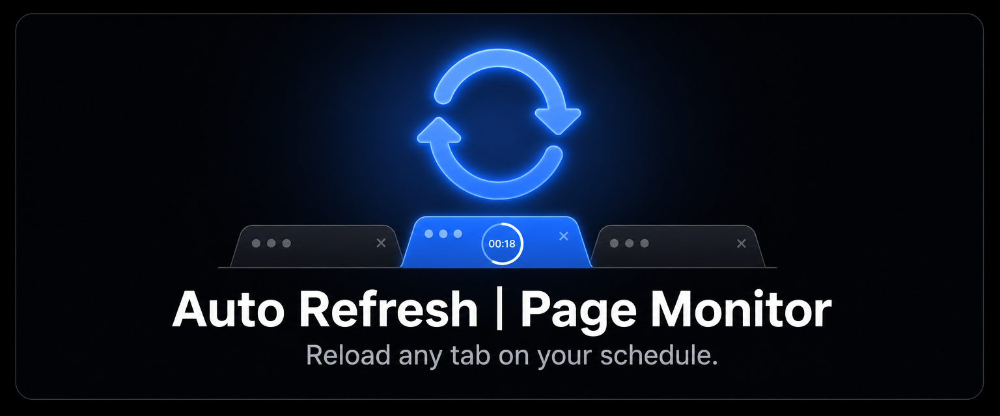

<p align="center">
  
</p>

<p align="center">
  <a href="https://chromewebstore.google.com/detail/auto-refresh-page-monitor/mhmkhlbgacabeffhkalebjnbnfakfdbj"></a>
  <a href="https://chromewebstore.google.com/detail/auto-refresh-page-monitor/mhmkhlbgacabeffhkalebjnbnfakfdbj"></a>
  <a href="https://github.com/kirillDevPro/auto-refresh-page-monitor/actions/workflows/ci.yml"></a>
  
  <a href="LICENSE"></a>
  
</p>

<p align="center">
  <a href="#features">Features</a> ·
  <a href="#how-it-works">How it works</a> ·
  <a href="#permissions--data">Permissions &amp; data</a> ·
  <a href="#install">Install</a> ·
  <a href="#development">Development</a> ·
  <a href="#privacy">Privacy</a> ·
  <a href="#license">License</a>
</p>

Auto Refresh | Page Monitor is a Chrome (Manifest V3) extension that reloads browser tabs on a schedule you
choose — one tab at a time, in bulk across a window or tab group, or automatically by URL pattern. It reloads
pages; it never reads what is on them. The extension requests **no host permissions**, has **no backend**, and
sends **nothing anywhere** — the only network traffic it causes is the page reload you asked for.

## Features

- **Per-tab auto-refresh** — start or stop a timer on the current tab from the toolbar popup, using a preset,
  a custom interval, or a **random interval range** (min–max; each cycle picks a fresh value in the band).
- **Interval jitter** — optional ±% randomization so refreshes don't hit a site on a fixed cadence
  (per tab, per rule, or as a global default).
- **Bulk actions** — start or stop auto-refresh across **every tab in the current window** or **the active
  tab's group**, from the popup or a keyboard shortcut. A cap of 30 limits how many tabs a single bulk
  action will start, so one keystroke cannot arm every tab you have open. (Starting tabs one at a time is
  not capped.)
- **Scheduled refreshes** — URL-pattern rules that auto-start a refresh whenever a matching page opens, with
  a per-rule interval, cache mode, jitter setting, and auto-recover setting.
- **Keyboard shortcuts** — control the current tab or a whole window/group without opening the popup.
- **Smart pause** — optionally skip a refresh while you are actively viewing the tab, so a page never reloads
  out from under you; background tabs keep refreshing.
- **Auto-recover** (opt-in) — reload a tab whose page failed or hung to load, with backoff, and fast-forward
  pending recoveries when the network reconnects.
- **Cache mode** — normal reload or hard reload (bypass cache), per tab or per rule.
- **Statistics & activity log** — per-URL, daily and hourly refresh counts plus a recent-activity log, all
  stored locally and resettable from the Settings page.
- **27 interface languages**, a light / dark / auto theme, and a compact scroll-free popup.

## How it works

The extension is a Manifest V3 service worker plus two UI surfaces, and it is built so that a suspended
service worker cannot silently lose a running timer:

- **Timers are `chrome.alarms`, not `setInterval`.** An alarm survives service-worker suspension; a timer
  inside the worker does not. A keepalive alarm ticks every 30 seconds and doubles as the health check —
  it detects a suspension or crash, re-arms alarms that went missing, and revives the badge countdown.
- **All durable state lives in `chrome.storage`.** Per-tab state, scheduled rules, statistics, and the
  activity log are written through, so a cold-started worker rebuilds from storage rather than from memory.
- **Reloading uses `chrome.tabs.reload()`**, which requires no host permission and cannot touch page content.
- **Audio plays from an offscreen document**, because a Manifest V3 service worker cannot play sound itself.

`background/`, `popup/`, and `settings/` are deliberately separate module trees that share no code; the only
shared code lives in `shared/` as dependency-free leaf modules. A handful of small helpers are therefore
duplicated on purpose — the comments at each site say so and name the twin to keep in sync.

## Permissions & data

| Permission | Why it's needed |
|---|---|
| `storage` | Save settings, per-tab timer state, scheduled rules, statistics, and the activity log. |
| `tabs` | Read tab URLs and titles to drive the per-tab UI, match URL-pattern rules, and record per-URL statistics. Chrome shows this as "Read your browsing history" at install. |
| `alarms` | Schedule the refresh timers so they survive service-worker suspension. |
| `offscreen` | Play the optional notification sound (a service worker cannot). |
| `unlimitedStorage` | Keep statistics and the activity log without hitting the default local-storage quota. |
| `idle` | Detect whether you are actively using the browser, for the smart-pause feature. |
| `contextMenus` | Add the right-click controls for the current tab. |
| `webNavigation` (**optional**) | Requested at runtime **only** if you enable auto-recover, to detect a failed or hung page load. Not requested at install. |

**Not requested:** any host permission, `scripting`, `tabGroups`, `history`, `cookies`, or `downloads`. The
extension injects no content script, so it cannot read or modify the pages you visit. Bulk group actions read
`tab.groupId` under the existing `tabs` permission rather than requesting `tabGroups`, which would carry an
install-time warning. `tests/test_permission_drift.mjs` pins this permission surface so it cannot grow by
accident.

## Keyboard shortcuts

Defaults, customizable at `chrome://extensions/shortcuts` (Chrome allows at most four suggested bindings):

| Shortcut | Action |
|---|---|
| `Alt+Shift+R` | Start / stop auto-refresh on the current tab |
| `Alt+Shift+P` | Pause / resume auto-refresh on the current tab |
| `Alt+Shift+U` | Start / stop auto-refresh on every tab in the window |
| `Alt+Shift+E` | Start / stop auto-refresh on every tab in the current tab's group |

The Settings page (General tab) also lists these with their current bindings.

## Install

**From the Chrome Web Store (recommended)**

1. Open the listing: **[Auto Refresh | Page Monitor](https://chromewebstore.google.com/detail/auto-refresh-page-monitor/mhmkhlbgacabeffhkalebjnbnfakfdbj)**.
2. Click **Add to Chrome**, then **Add extension** to confirm.

**From source (development)**

1. Download or clone this repository.
2. Open `chrome://extensions` and enable **Developer mode** (top right).
3. Click **Load unpacked** and select the repository folder.

## Development

There is no build step and there are no dependencies — Chrome loads the raw JavaScript directly. After a code
change, click the reload icon on the extension card; for service-worker logic, also open the card's
**Inspect** link to force a fresh start and see the logs.

```bash
# syntax-check every .js / .mjs in the tree (Node 20+)
find . -path ./.git -prune -o \( -name '*.js' -o -name '*.mjs' \) -print0 | xargs -0 -n1 -P4 node --check
# the full headless suite — stops at the first failure, like CI
for f in tests/*.mjs; do node "$f" || exit 1; done
```

CI runs these same two checks on every pull request and on every push to `main`.

Two of the tests guard promises this project makes in public rather than any single feature:
`tests/test_archive_contents.mjs` pins what the store package may contain, and
`tests/test_no_network.mjs` pins the "originates no network request of its own" claim made in this
README, in `SECURITY.md`, and in the published privacy policy.

> **The minimum refresh interval is 30 seconds.** In a packed (published) extension Chrome clamps alarm
> periods below 0.5 minutes, so a shorter interval would simply never fire. Unpacked development mode has no
> such floor, which means sub-30-second intervals appear to work when loaded unpacked — do not trust unpacked
> timing when reasoning about intervals.

Project layout: `background/` (service-worker modules), `popup/` (toolbar UI), `settings/` (options page),
`shared/` (dependency-free leaves shared across trees), `offscreen.{html,js}` (audio playback), `_locales/`
(27 locales), `icons/`, `sounds/`, `tests/` (headless Node tests, not shipped).

## Building the store package

The upload package is produced from a **committed** tree with `git archive`, which honors the `export-ignore`
rules in `.gitattributes` so development files never ship:

```bash
git archive --format=zip -o "auto-refresh-$(node -p "require('./manifest.json').version").zip" HEAD
```

Because `git archive` reads `HEAD`, an uncommitted `.gitattributes` has no effect. The resulting zip contains
only `manifest.json`, `background/`, `popup/`, `settings/`, `shared/`, `_locales/`, `icons/`, `sounds/`,
`offscreen.{html,js}`, and `LICENSE`.

## Privacy

The extension has no backend, no accounts, no advertising, and no remote or third-party analytics. It
**originates no network request of its own**: the only `fetch()` calls in the code read the extension's own
bundled `_locales/<lang>/messages.json` through `chrome.runtime.getURL()`, which never touches the network.
(Reloading a tab does of course make *that page* fetch itself again, exactly as pressing F5 would.)

Three things are worth stating plainly rather than hiding behind "we store nothing":

- The extension **does** keep local statistics, and those records include **full page URLs** (path and query
  string included) for the tabs you refresh. The activity log keeps up to 200 recent entries. Both stay on
  your device and are resettable from the Settings page.
- Retention is **enforced on write, not by a clock**: statistics older than 90 days and log entries older
  than 7 days are pruned the next time the extension writes to that store (or, for the log, when you open
  the Settings view). If you stop using the extension entirely, the last records simply stay until you
  reset them or uninstall.
- Your **preferences** are saved to `chrome.storage.sync`, which means Chrome — not this extension —
  replicates them to your other signed-in browsers when you have Chrome Sync turned on. Your scheduled rules,
  statistics, and activity log are **not** synced; they stay in local storage on that device.

Nothing is ever sent to the author, and there is no server to send it to. Full details are in the
**[Privacy Policy](https://kirilldevpro.github.io/auto-refresh-page-monitor/)**.

## Contributing

Issues and pull requests are welcome. By submitting a contribution you agree it is licensed to the author
under the terms in [LICENSE](LICENSE) (section 4). Please keep the permission surface minimal, keep code
comments and docstrings in English, and run `node --check` plus the full test suite before opening a pull
request.

## Security

Found a security problem? See [SECURITY.md](SECURITY.md) — please report it privately rather than in a public
issue, and redact any personal URLs from logs you attach.

## License

Source-available under a [proprietary license](LICENSE), © 2026 kirillDevPro. You may **view the source** and
run the extension for your **own personal, non-commercial use**. You may **not** redistribute it, publish it
(or any modified or rebranded version) to the Chrome Web Store or any other store or platform, or use it
commercially. See [LICENSE](LICENSE) for the full terms, including the GitHub-platform and contribution
carve-outs, the warranty disclaimer, and the limitation of liability. This is **not** open-source software.
